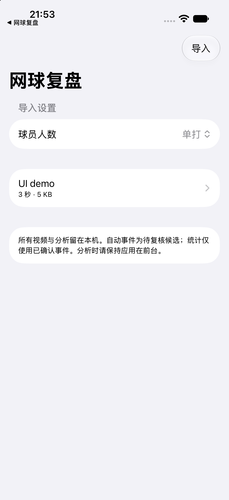
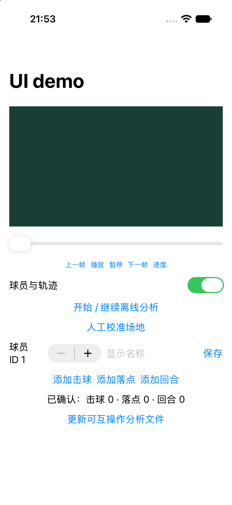
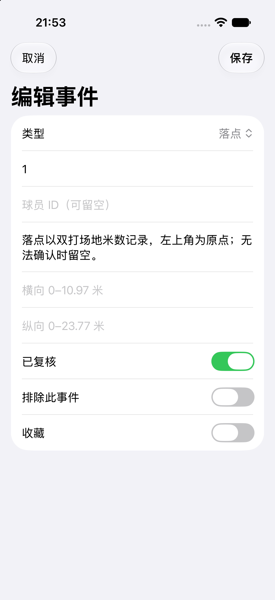

<p align="center">
  
</p>

<h3 align="center">Private tennis video analysis that runs on your own Mac or iPhone.<br>Track the ball, the players and the court, then review every shot.</h3>

<p align="center">
  <a href="https://github.com/Paulyang5049/Tennis-AI-Tracker/actions/workflows/test.yml"></a>
  <a href="https://github.com/Paulyang5049/Tennis-AI-Tracker/actions/workflows/ios.yml"></a>
  <a href="LICENSE"></a>
  
  
  <a href="https://colab.research.google.com/github/Paulyang5049/Tennis-AI-Tracker/blob/main/notebooks/01_train_ball_yolo26.ipynb"></a>
</p>

<p align="center"><b>English</b> · <a href="README.zh-CN.md">简体中文</a></p>

---

## Why Tennis AI Local

- **Your footage stays with you.** After a one-time model download, analysis runs locally on Apple Silicon, CPU or CUDA. No account, no upload, no server.
- **Made for real matches.** Singles or doubles, from a fixed full-court phone recording or a broadcast clip.
- **Evidence you can check.** Automatic detections stay labelled as candidates. Only events you review count in statistics, and every number links back to the frames behind it.
- **Open from end to end.** Models, training notebooks, data contracts and validation results are all in this repository.

## See it


<table>
  <tr><th>Match library</th><th>Video review</th><th>Event editor</th></tr>
  <tr>
    <td></td>
    <td></td>
    <td></td>
  </tr>
</table>

<sub>Desktop app in its empty state and iPhone simulator captures of the native SwiftUI screens. The green video area is a UI test fixture; no match results are simulated.</sub>

## What it does today

| Capability | Status |
|---|---|
| Player detection, tracking and body pose (singles and doubles) | ✅ Works. IDs can still switch after long occlusions |
| Ball detection with a short trail | ✅ Works. Tiny far-court balls remain hard; try the opt-in TrackNet model (`--ball-model tracknet-v2`) |
| Court keypoints and a live mini-court | ✅ Works, with four-corner manual calibration as a fallback |
| Synchronized replay, exact-frame review and clip export with audio | ✅ Works |
| Pause and resume long analyses; portable analysis folders | ✅ Works |
| Hit, bounce and rally candidates | 🧪 Experimental. Review before they count; try `--event-detector contact-v2` |
| Stroke type (serve, forehand, backhand, volley, overhead) and spin (topspin, slice, flat) | ✍️ Manual labels; 🧪 opt-in candidates: `--stroke-detector stroke-v1` (serve, forehand, backhand, volley) and `--spin-detector wrist-v1` (slice/topspin) |
| Native iPhone app (SwiftUI, AVFoundation, Core ML) | 🧪 Developer build from source; not on the App Store |
| Accuracy on labelled phone footage | 🔜 Waiting for labelled matches. [Help wanted](#help-build-it) |

## Quick start (macOS)

```sh
git clone https://github.com/Paulyang5049/Tennis-AI-Tracker.git
cd Tennis-AI-Tracker
brew install ffmpeg uv
uv venv --python 3.11 .venv && uv pip install --python .venv/bin/python -e '.[dev]'
.venv/bin/tennis-ai setup   # downloads the models once
.venv/bin/tennis-ai app     # opens http://127.0.0.1:7860
```

Upload a video, choose Singles or Doubles and click **Analyze video**. Prefer the terminal?

```sh
.venv/bin/tennis-ai analyze my-match.mp4 --output outputs/my-match
```

Next: [usage guide](docs/USAGE.md) · [iPhone build](ios/README.md) · [train a ball detector in Colab](notebooks/01_train_ball_yolo26.ipynb)

## How it works


1. **Detect.** YOLO26 finds players, rackets and the ball in every frame; a pose model adds body keypoints.
2. **Track.** ByteTrack keeps player identities, a temporal gate selects one ball, and gaps are only bridged between nearby observations.
3. **Map the court.** A heatmap model finds 14 court keypoints and fits the court geometry, so positions appear on a mini-court.
4. **Review.** Candidates for hits, bounces and rallies are listed against the video. You confirm, correct or exclude them, and only reviewed facts enter statistics.

Everything is written to a self-contained analysis folder with versioned [data contracts](contracts/README.md) shared by the Python and Swift apps.

## Measured, not promised


<sub>Development checks from 10 September 2026. Coverage shows whether an estimate exists, not whether it is correct. Labelled accuracy, iPhone performance and battery results are still open; see [VALIDATION.md](VALIDATION.md) and [implementation status](docs/IMPLEMENTATION_STATUS.md).</sub>

## Roadmap

- [x] Local analysis, synchronized replay and exact-frame review
- [x] Portable analysis packages, resume after interruption, clip export with audio
- [x] Shared Python/Swift data contracts and a native iOS developer build
- [x] Gap-tolerant hit candidates (`contact-v2`, experimental)
- [ ] Validate contact, stroke and spin candidates on human-labelled clips
- [x] Spin labels (topspin, slice, flat) in both apps, with experimental wrist-based candidates
- [x] Stroke-type candidates (serve, forehand, backhand, volley) and forehand/backhand × spin report counts (experimental)
- [x] Multi-frame TrackNet ball detector (opt-in, experimental)
- [x] Gap-tolerant hit candidates on iPhone as well as desktop
- [ ] Labelled phone-footage benchmark, singles first
- [ ] TestFlight beta

The detailed plan is in [docs/plans](docs/plans/2026-09-11-1411-feat-tennis-coaching-intelligence-plan.md).

## Help build it

- **Play tennis?** A clearly described failure case is valuable even without code. Footage needs the consent of everyone who can be identified in it; use the [footage contribution form](https://github.com/Paulyang5049/Tennis-AI-Tracker/issues/new?template=footage_contribution.yml).
- **Like labelling?** The [annotation guide](docs/ANNOTATION.md) explains how ball, contact and bounce labels feed the benchmark.
- **Write code?** Start with [CONTRIBUTING.md](CONTRIBUTING.md) and issues tagged [good first issue](https://github.com/Paulyang5049/Tennis-AI-Tracker/labels/good%20first%20issue).

If this project is useful to you, a ⭐ helps other players find it.

## Citation

If you use Tennis AI Local in research, please cite it using the metadata in [CITATION.cff](CITATION.cff) (GitHub shows a **Cite this repository** button).

## License

Tennis AI Local is released under the [GNU AGPL v3](LICENSE). Downloaded models, datasets and third-party repositories keep their own terms; see [THIRD_PARTY.md](THIRD_PARTY.md). Please read the [code of conduct](CODE_OF_CONDUCT.md) and [security policy](SECURITY.md).
