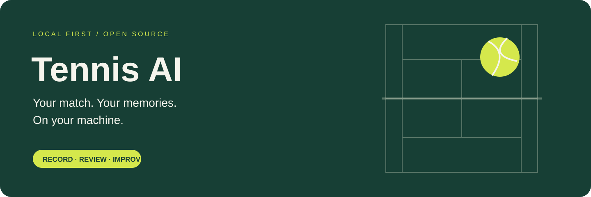
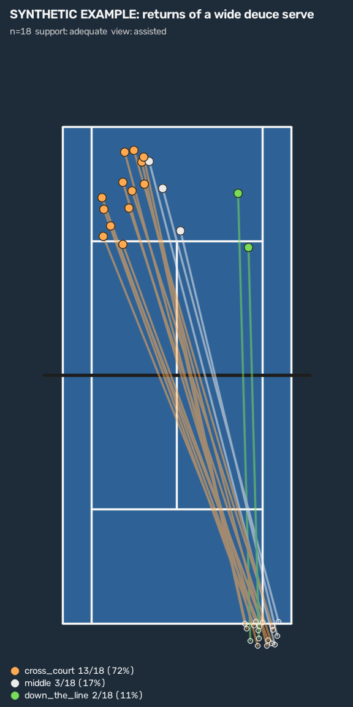
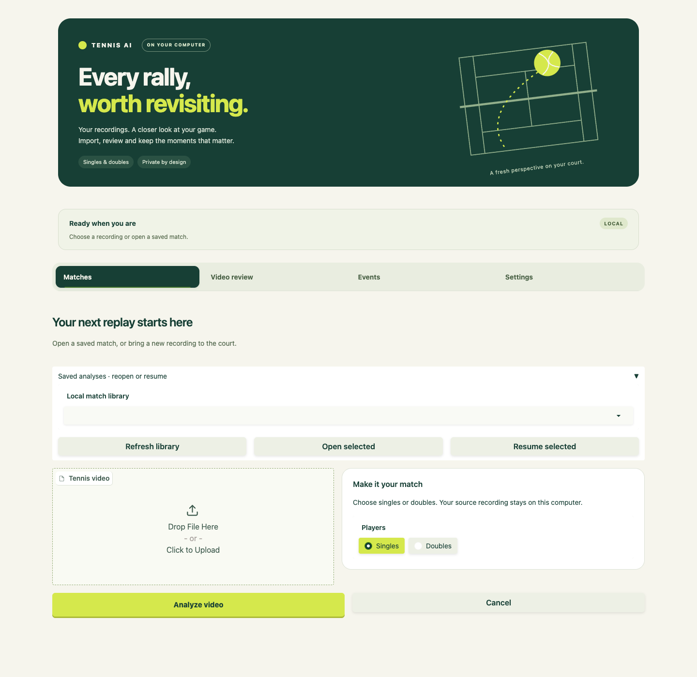
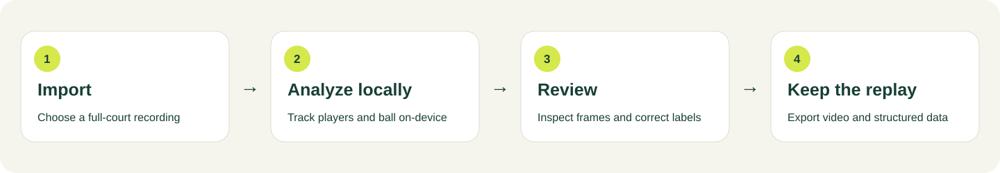
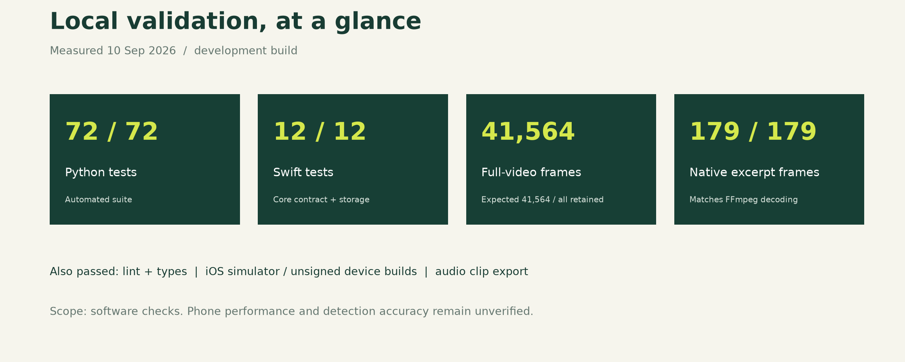
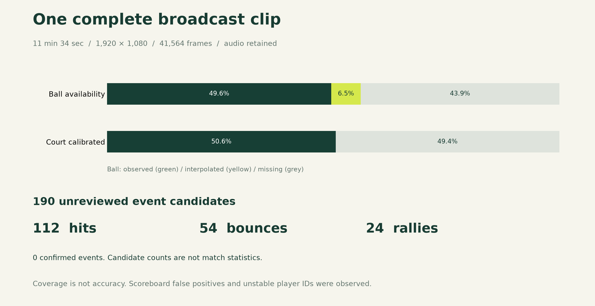

<p align="center">
  
</p>

<h3 align="center">Turn match video into shot patterns you can scout.<br>Track the ball, the players and the court on your own Mac, then see where every shot goes.</h3>

<p align="center">
  <a href="https://github.com/Paulyang5049/Tennis-AI-Tracker/actions/workflows/test.yml"></a>
  <a href="https://github.com/Paulyang5049/Tennis-AI-Tracker/actions/workflows/ios.yml"></a>
  <a href="LICENSE"></a>
  
  
  
  <a href="https://colab.research.google.com/github/Paulyang5049/Tennis-AI-Tracker/blob/main/notebooks/01_train_ball_yolo26.ipynb"></a>
</p>

<p align="center"><b>English</b> · <a href="README.zh-CN.md">简体中文</a></p>

<p align="center">
  <a href="#scout-an-opponent">Scouting</a> ·
  <a href="#quick-start-macos">Quick start</a> ·
  <a href="#what-it-does-today">Status</a> ·
  <a href="#how-it-works">How it works</a> ·
  <a href="#roadmap">Roadmap</a> ·
  <a href="docs/research/2026-11-10-model-landscape.md">Model research</a>
</p>

---

## Why Tennis AI Local

- **Your footage stays with you.** After a one-time model download, analysis runs locally on Apple Silicon, CPU or CUDA. No account, no upload, no server.
- **Made for the broadcast view.** The high camera behind the baseline that you see on TV. Singles first; doubles is supported in the data but not yet validated.
- **Answers tactical questions.** "When I serve wide on the deuce side, where does the return go?" Each answer comes with a court map, the sample size and the clips behind it.
- **Evidence you can check.** Automatic detections stay labelled as candidates. Only events you review count in statistics, and every number links back to the frames behind it.
- **Open from end to end.** Models, training notebooks, data contracts and validation results are all in this repository.

## Scout an opponent

<table>
<tr>
<td width="46%"></td>
<td>

Every shot becomes a path on a 2D court: **where the hitter stood → where the ball bounced**. Paths are grouped by what came before, so you can ask what a player tends to do in a given situation.

```sh
tennis-ai tendency outputs/my-match \
  --participant opponent \
  --where role=return \
  --incoming serve_side=deuce \
  --incoming direction=wide \
  --map return.png --output return.json
```

You get direction, depth and width distributions, each with its count, a 95% interval and the shot IDs to replay. Fewer than eight shots is marked `limited`.

<sub>The picture uses made-up shots to show the output format. It is not a match result.</sub>

</td>
</tr>
</table>

Filters you can combine: `role` (serve, return, rally), `stroke`, `spin`, `serve_side`, `direction`, `depth`, `width`, on the shot itself (`--where`) and on the shot it answers (`--incoming`). Add `--view human_verified` to count only what you have confirmed.

> [!NOTE]
> Shot paths are built from hits, bounces and hit-to-bounce links in the analysis. Automatic bounce and hit detection is still experimental, so today a trustworthy scouting report needs those events reviewed by hand. Reducing that work is the next stage of the [plan](docs/plans/2026-11-10-feat-shot-pattern-scouting-plan.md).

## See it



<sub>Desktop app in its empty state.</sub>

## What it does today

| Capability | Status |
|---|---|
| Player detection, tracking and body pose (singles and doubles) | ✅ Works. IDs can still switch after long occlusions |
| Ball detection with a short trail | ✅ Works. Tiny far-court balls remain hard; try the opt-in TrackNet model (`--ball-model tracknet-v2`) |
| 2D shot paths and tendency queries with court maps (`tennis-ai shots`, `tennis-ai tendency`) | 🆕 First version. Tested on synthetic data; needs reviewed events |
| Court keypoints and a live mini-court | ✅ Works, with four-corner manual calibration as a fallback |
| Synchronized replay, exact-frame review and clip export with audio | ✅ Works |
| Pause and resume long analyses; portable analysis folders | ✅ Works |
| Hit, bounce and rally candidates | 🧪 Experimental. Review before they count; try `--event-detector contact-v2` |
| Stroke type (serve, forehand, backhand, volley, overhead) and spin (topspin, slice, flat) | ✍️ Manual labels; 🧪 opt-in candidates: `--stroke-detector stroke-v1` (serve, forehand, backhand, volley) and `--spin-detector wrist-v1` (slice/topspin) |
| Accuracy on labelled broadcast footage | 🔜 Waiting for labelled matches. [Help wanted](#help-build-it) |
| Native iPhone app and phone-camera capture | ⏸️ Paused. The source is kept in [ios/](ios/README.md) |

## Quick start (macOS)

```sh
git clone https://github.com/Paulyang5049/Tennis-AI-Tracker.git
cd Tennis-AI-Tracker
brew install ffmpeg uv
uv venv --python 3.11 .venv && uv pip install --python .venv/bin/python -e '.[dev]'
.venv/bin/tennis-ai setup   # downloads the models once
.venv/bin/tennis-ai app     # opens http://127.0.0.1:7860
```

Upload a video, choose Singles or Doubles and click **Analyze video**. Prefer the terminal?

```sh
.venv/bin/tennis-ai analyze my-match.mp4 --output outputs/my-match
```

Next: [usage guide](docs/USAGE.md) · [scouting plan](docs/plans/2026-11-10-feat-shot-pattern-scouting-plan.md) · [train a ball detector in Colab](notebooks/01_train_ball_yolo26.ipynb)

## How it works



1. **Detect.** YOLO26 finds players, rackets and the ball in every frame; a pose model adds body keypoints.
2. **Track.** ByteTrack keeps player identities, a temporal gate selects one ball, and gaps are only bridged between nearby observations.
3. **Map the court.** A heatmap model finds 14 court keypoints and fits the court geometry, so positions appear on a mini-court.
4. **Review.** Candidates for hits, bounces and rallies are listed against the video. You confirm, correct or exclude them, and only reviewed facts enter statistics.
5. **Scout.** Each hit is joined to its bounce to form a shot path. Because both ends are on the ground, the court mapping places them exactly; no 3D reconstruction of the ball in flight is needed.

Everything is written to a self-contained analysis folder with versioned [data contracts](contracts/README.md).

The models are published open ones (YOLO26, TrackNet) used as they are. The [model research note](docs/research/2026-11-10-model-landscape.md) explains the maths behind them, where they fall short on a tennis ball, and the path to fine-tuned and eventually custom models.

## Measured, not promised

<details>
<summary>Validation charts from the September 2026 development checks</summary>





</details>

Coverage shows whether an estimate exists, not whether it is correct. No labelled accuracy figure exists yet for the ball, hits, bounces or shot paths; see [VALIDATION.md](VALIDATION.md) and [implementation status](docs/IMPLEMENTATION_STATUS.md).

## Roadmap

| Stage | What | State |
|---|---|---|
| Foundation | Local analysis, replay, exact-frame review, portable packages, resume, clip export | ✅ Done |
| Candidates | Gap-tolerant hits (`contact-v2`), spin candidates, opt-in TrackNet ball model | 🧪 Experimental |
| Shot paths | 2D shot paths, tendency queries and court maps | 🆕 First version |
| Broadcast handling | Skip replays and close-ups; follow camera pans | ⏳ Next |
| Bounce and hit models | Replace the heuristics, link hits to bounces automatically | ⏳ Needs labels |
| Ball tracker fine-tuning | Fine-tune TrackNet on broadcast tennis, compare with other open models | ⏳ Needs labels |
| Stroke classification | Forehand, backhand and serve from pose | ⏳ Planned |
| Scouting page | Filters, court map and clip replay inside the desktop app | ⏳ Planned |
| 3D extras | Ball speed and net clearance from a physics fit | 💤 Later |
| Custom models | After the foundation: see the [model research note](docs/research/2026-11-10-model-landscape.md) | 💤 Long term |

Plans: [shot-pattern scouting](docs/plans/2026-11-10-feat-shot-pattern-scouting-plan.md) · [coaching intelligence](docs/plans/2026-09-11-1411-feat-tennis-coaching-intelligence-plan.md).

## Help build it

- **Play tennis?** A clearly described failure case is valuable even without code. Footage needs the consent of everyone who can be identified in it; use the [footage contribution form](https://github.com/Paulyang5049/Tennis-AI-Tracker/issues/new?template=footage_contribution.yml).
- **Like labelling?** The [annotation guide](docs/ANNOTATION.md) explains how ball, contact and bounce labels feed the benchmark.
- **Write code?** Start with [CONTRIBUTING.md](CONTRIBUTING.md) and issues tagged [good first issue](https://github.com/Paulyang5049/Tennis-AI-Tracker/labels/good%20first%20issue).

If this project is useful to you, a ⭐ helps other players find it.

## Citation

If you use Tennis AI Local in research, please cite it using the metadata in [CITATION.cff](CITATION.cff) (GitHub shows a **Cite this repository** button).

## License

Tennis AI Local is released under the [GNU AGPL v3](LICENSE). Downloaded models, datasets and third-party repositories keep their own terms; see [THIRD_PARTY.md](THIRD_PARTY.md). Please read the [code of conduct](CODE_OF_CONDUCT.md) and [security policy](SECURITY.md).
