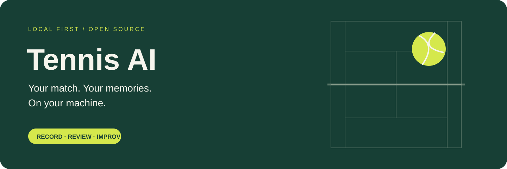
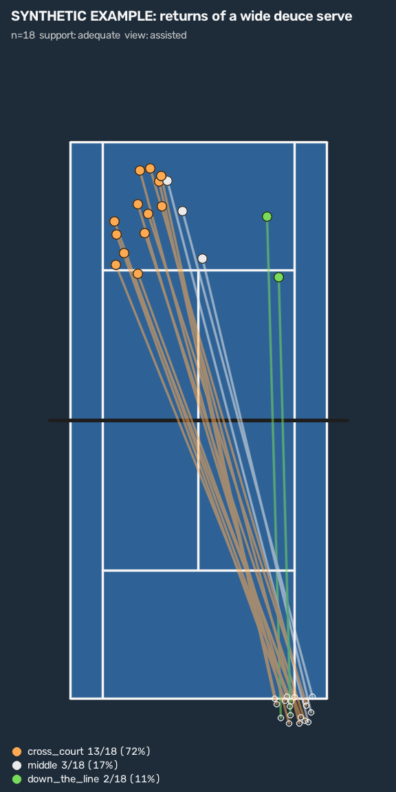

<p align="center">
  
</p>

<h3 align="center">把比赛视频变成可以侦察的球路。<br>在自己的 Mac 上跟踪球、球员和场地，看清每一拍打向哪里。</h3>

<p align="center"><a href="README.md">English</a> · <b>简体中文</b></p>

<p align="center">
  <a href="#侦察对手">侦察对手</a> ·
  <a href="#快速开始macos">快速开始</a> ·
  <a href="#现在能做什么">功能状态</a> ·
  <a href="#工作原理">工作原理</a> ·
  <a href="#路线图">路线图</a> ·
  <a href="docs/research/2026-11-10-model-landscape.md">模型调研</a>
</p>

---

## 为什么用它

- **视频不离开你的设备。** 首次下载模型之后，分析全部在本机完成（Apple Silicon、CPU 或 CUDA）。不需要账号，不上传，没有服务器。
- **面向转播机位。** 也就是电视上常见的底线后方高机位。先做单打；双打在数据格式里保留，但还没有验证。
- **回答战术问题。** “我在一区发外角时，他的接发球打到哪里？”每个答案都带球场图、样本数和对应的片段。
- **结论可以核对。** 自动检测结果一律标为"候选"。只有你确认过的事件才进入统计，每个数字都能回到对应的画面。
- **全部开源。** 模型、训练 Notebook、数据格式和验证结果都在这个仓库里。

## 侦察对手

<table>
<tr>
<td width="46%"></td>
<td>

每一拍都变成二维球场上的一条球路：**击球者站在哪里 → 球落在哪里**。球路按“上一拍是什么”分组，所以可以问某个选手在特定情况下偏好怎么打。

```sh
tennis-ai tendency outputs/my-match \
  --participant opponent \
  --where role=return \
  --incoming serve_side=deuce \
  --incoming direction=wide \
  --map return.png --output return.json
```

输出方向、深度、宽度三个分布，每一项都有数量、95% 区间和可回看的击球 ID。样本少于 8 个时标为 `limited`。

<sub>图中是虚构的击球，只用来展示输出格式，不是比赛结果。</sub>

</td>
</tr>
</table>

可以组合的筛选条件：`role`（serve、return、rally）、`stroke`、`spin`、`serve_side`、`direction`、`depth`、`width`，分别作用在这一拍（`--where`）和它回应的上一拍（`--incoming`）上。加 `--view human_verified` 只统计你确认过的事件。

> [!NOTE]
> 球路由分析结果里的击球、落地以及两者的关联生成。自动的落地和击球检测还在实验阶段，所以目前要得到可信的侦察报告，需要先人工复核这些事件。减少这部分工作量是[规划](docs/plans/2026-11-10-feat-shot-pattern-scouting-plan.md)的下一阶段。

## 现在能做什么

| 功能 | 状态 |
|---|---|
| 球员检测、跟踪和身体姿态（单打、双打） | ✅ 可用。长时间遮挡后 ID 仍可能切换 |
| 球的检测与轨迹 | ✅ 可用。远端小球仍有难度，可试用多帧 TrackNet 模型（`--ball-model tracknet-v2`） |
| 二维球路、倾向查询和球场图（`tennis-ai shots`、`tennis-ai tendency`） | 🆕 第一版。用合成数据测试过；需要已复核的事件 |
| 场地关键点与小地图 | ✅ 可用，模型失败时可手动点四个角校准 |
| 同步回放、逐帧复盘、带声音导出片段 | ✅ 可用 |
| 长视频暂停与续跑；分析文件夹可整体搬移 | ✅ 可用 |
| 击球、落地、回合候选 | 🧪 实验中。确认后才计入统计；可试 `--event-detector contact-v2` |
| 击球类型（发球、正手、反手、截击、高压）与旋转（上旋、切削、平击） | ✍️ 手动标注；🧪 可选候选：`--stroke-detector stroke-v1`（发球、正手、反手、截击）和 `--spin-detector wrist-v1`（切削/上旋） |
| 带标注转播素材上的准确率 | 🔜 需要带标注的比赛。[欢迎参与](#参与) |
| 原生 iPhone App 和手机拍摄 | ⏸️ 暂时搁置。源码保留在 [ios/](ios/README.md) |

## 快速开始（macOS）

```sh
git clone https://github.com/Paulyang5049/Tennis-AI-Tracker.git
cd Tennis-AI-Tracker
brew install ffmpeg uv
uv venv --python 3.11 .venv && uv pip install --python .venv/bin/python -e '.[dev]'
.venv/bin/tennis-ai setup   # 首次下载模型
.venv/bin/tennis-ai app     # 打开 http://127.0.0.1:7860
```

上传视频，选择单打或双打，点击 **Analyze video**。也可以用命令行：

```sh
.venv/bin/tennis-ai analyze my-match.mp4 --output outputs/my-match
```

更多：[使用指南（英文）](docs/USAGE.md) · [球路侦察规划](docs/plans/2026-11-10-feat-shot-pattern-scouting-plan.md) · [在 Colab 训练球检测模型](notebooks/01_train_ball_yolo26.ipynb)

## 工作原理

1. **检测**：YOLO26 逐帧找出球员、球拍和球，姿态模型补充身体关键点。
2. **跟踪**：ByteTrack 保持球员身份，时间门控挑出唯一的球；只在相邻观测之间补短缺口。
3. **场地映射**：热图模型找到 14 个场地关键点并拟合几何，把位置画到小地图上。
4. **复盘**：击球、落地和回合候选对齐到视频上。由你确认、修改或排除，只有确认过的事实进入统计。
5. **侦察**：把每次击球和它的落点连成一条球路。两端都在地面上，场地映射可以直接定位，不需要重建球在空中的三维轨迹。

使用的是公开发布的模型（YOLO26、TrackNet），目前原样使用。[模型调研](docs/research/2026-11-10-model-landscape.md)解释了它们背后的数学、在网球上的不足，以及从微调到自研模型的路线。

## 路线图

| 阶段 | 内容 | 状态 |
|---|---|---|
| 基础 | 本地分析、回放、逐帧复盘、可搬移的分析包、续跑、片段导出 | ✅ 完成 |
| 候选检测 | 容忍缺口的击球候选（`contact-v2`）、旋转候选、可选 TrackNet 球模型 | 🧪 实验中 |
| 球路 | 二维球路、倾向查询、球场图 | 🆕 第一版 |
| 转播镜头处理 | 跳过回放和特写；跟随镜头摇移 | ⏳ 下一步 |
| 落地与击球模型 | 替换启发式规则，自动关联击球和落点 | ⏳ 需要标注 |
| 球追踪微调 | 用转播网球数据微调 TrackNet，并和其他公开模型比较 | ⏳ 需要标注 |
| 拍型分类 | 基于姿态判断正手、反手、发球 | ⏳ 计划中 |
| 侦察页面 | 桌面应用内的筛选、球场图和片段回看 | ⏳ 计划中 |
| 三维增强 | 用物理拟合估计球速和过网高度 | 💤 以后 |
| 自研模型 | 基础完成之后，见[模型调研](docs/research/2026-11-10-model-landscape.md) | 💤 长期 |

## 参与

- **会打网球**：描述清楚的失败案例就很有价值，不需要写代码。提交录像须征得画面中所有可识别人员的同意，请用 [录像提交表](https://github.com/Paulyang5049/Tennis-AI-Tracker/issues/new?template=footage_contribution.yml)。
- **愿意标注**：[标注指南](docs/ANNOTATION.md) 说明球、击球和落地标注如何进入评测。
- **会写代码**：先看 [CONTRIBUTING.md](CONTRIBUTING.md) 和标记为 [good first issue](https://github.com/Paulyang5049/Tennis-AI-Tracker/labels/good%20first%20issue) 的问题。

觉得有用的话，点个 ⭐ 能帮更多球友找到它。

## 许可

本项目采用 [GNU AGPL v3](LICENSE)。下载的模型、数据集和第三方仓库遵循各自条款，见 [THIRD_PARTY.md](THIRD_PARTY.md)。
